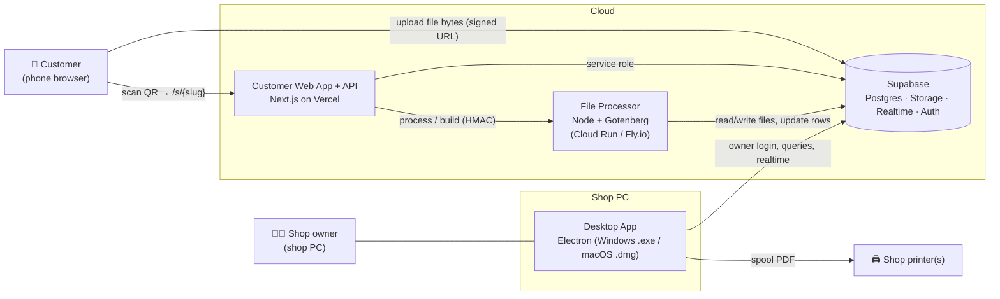
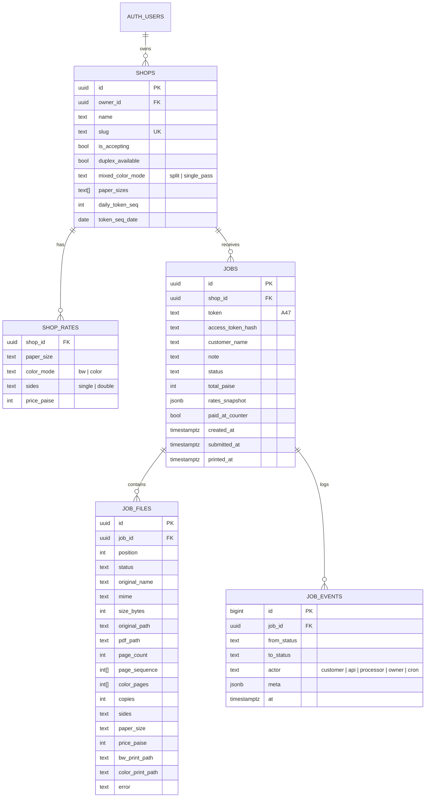
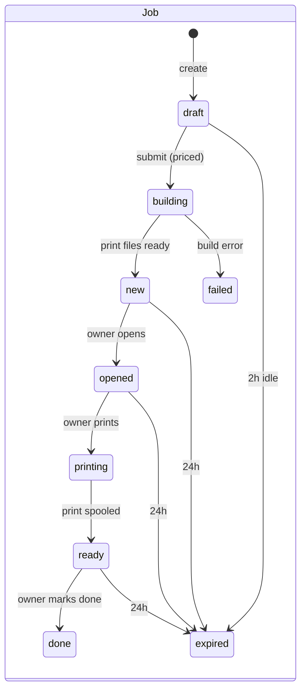
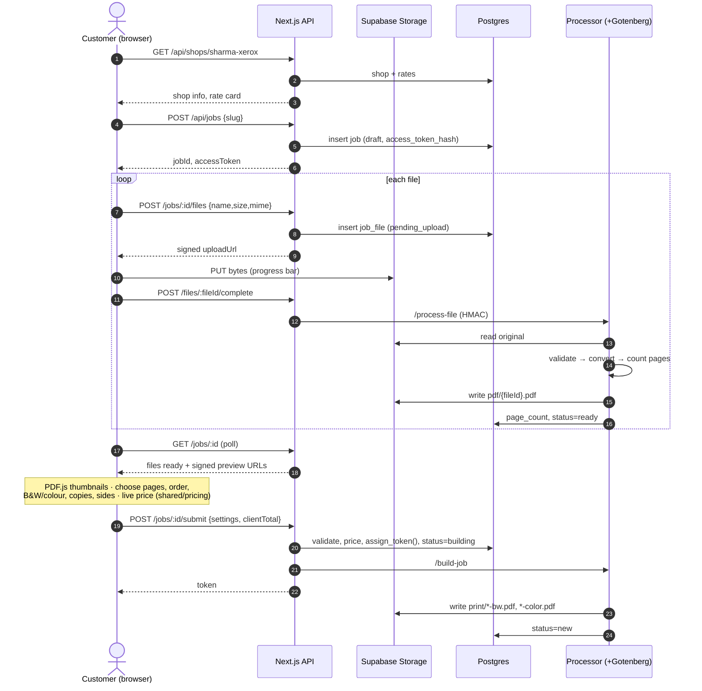
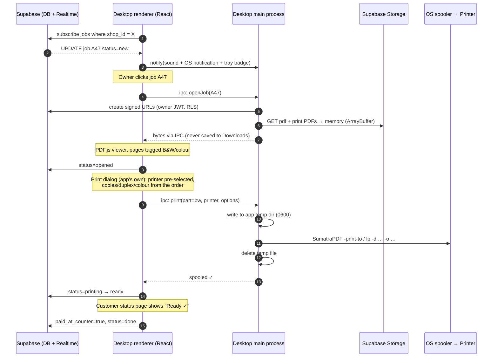
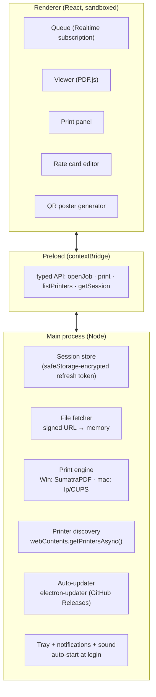
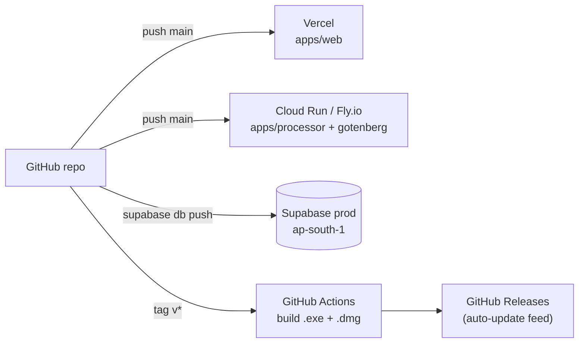

# The Print's Project — MVP Architecture

This describes the system for the MVP in [`MVP_PLAN.md`](./MVP_PLAN.md): the customer scans a QR
code, uploads files, customizes the order, sees the price, and sends it. The shop owner gets it
instantly in a desktop app, previews it, and prints it with the customer's settings.
Payment happens at the counter in the MVP. Online payment comes later ([`PLAN.md`](./PLAN.md)).

> Diagrams use Mermaid, which GitHub renders automatically.

---

## 1. System context



Main components:

| # | Component | Runs on | Responsibility |
|---|---|---|---|
| 1 | **Customer Web App** | Vercel (Next.js App Router) | Upload, page thumbnails, customization, live price, submit, status page |
| 2 | **Public API** | Same Next.js app (`/api/*` route handlers) | The only door customers use. Creates jobs, hands out signed upload URLs, validates and prices orders, assigns tokens, rate limits |
| 3 | **File Processor** | Container on Cloud Run or Fly.io (Node + Fastify) with a **Gotenberg** sidecar | Validates files, converts Office/images to PDF, counts pages, builds print-ready PDFs |
| 4 | **Supabase** | Managed (region **ap-south-1 Mumbai**) | Postgres + Row Level Security, private file storage, Realtime change feed, owner Auth, `pg_cron` |
| 5 | **Desktop App** | Shop PC (Electron + React + Vite) | Owner login, live queue, in-app preview, printing, rate card, QR poster, tray and notifications |
| 6 | **Shared package** | Imported by 1, 2, 3, 5 | Pricing function, page-range parser, Zod schemas, status enums |

---

## 2. Key architecture decisions

| Decision | Choice | Why | Trade-off |
|---|---|---|---|
| Backend platform | **Supabase** (+ a thin Next.js API) | DB, storage, realtime and auth in one place, so there is no backend server to run; free tier is enough for a pilot | Some lock-in; mitigated because it's plain Postgres + S3-style storage |
| Customer access | **Customers never talk to the DB directly.** Only the API does (service role); files are uploaded via signed URLs | Simple, hard to abuse, no anonymous RLS puzzles | One extra network hop |
| Customer identity | No login. Each job gets a random **job access token** (kept in the browser's sessionStorage, stored **hashed** in DB) | Zero friction at the counter | Clearing the browser loses access to the status page (acceptable) |
| Office → PDF | **Gotenberg** (LibreOffice in Docker) | Accurate page counts and *preview = printout* | Needs a container host (Vercel can't run LibreOffice) |
| Page counting and print building | **Server-side** (`pdf-lib`) | The price is based on the true page count, never on what the browser says | Small processing delay (≈1–5 s per file) |
| Owner client | **Electron** | One TypeScript codebase → `.exe` + `.dmg`; built-in Chromium for PDF.js preview | Bigger installer (~90 MB) |
| Printing | **Native OS spooler**: SumatraPDF (bundled) on Windows, CUPS `lp` on macOS | Sharp vector output, exact copies/duplex/colour flags, fast on 100+ page docs; the same path becomes silent auto-print in Phase 2 | Short-lived temp file in the app's private folder (deleted right after spooling) |
| Realtime to owner | **Supabase Realtime** (`postgres_changes` on `jobs`, filtered by `shop_id`) | New job shows up in about 1 s with no custom WebSocket server | Requires owner to be authenticated (they are) |
| Money | Integer **paise**, price computed on the server with the **rate card snapshotted** in the order | No rounding bugs; old orders never change price | — |

---

## 3. Repository layout (monorepo)

```
/
├─ apps/
│  ├─ web/                    # Next.js: customer UI + /api route handlers
│  │  ├─ app/s/[slug]/        #   upload → customize → review → token screen
│  │  ├─ app/j/[jobId]/       #   live status page
│  │  └─ app/api/...          #   public API (see §6)
│  ├─ processor/              # Node + Fastify: /process-file, /build-job, /cleanup
│  └─ desktop/                # Electron
│     ├─ src/main/            #   main process: auth storage, printing, file fetch, updater, tray
│     ├─ src/preload/         #   narrow, typed IPC bridge (contextBridge)
│     └─ src/renderer/        #   React UI: queue, viewer (PDF.js), rate card, settings, QR
├─ packages/
│  └─ shared/                 # pricing.ts, pageRange.ts, schemas.ts (Zod), status.ts, types
├─ supabase/
│  ├─ migrations/             # tables, RLS policies, functions, pg_cron schedules
│  └─ seed.sql                # demo shop + rates for local dev
├─ infra/
│  └─ docker-compose.yml      # local: gotenberg + processor (Supabase via `supabase start`)
└─ docs: PLAN.md, MVP_PLAN.md, ARCHITECTURE.md
```

Tooling: **pnpm workspaces + Turborepo**, TypeScript strict, Vitest (unit), Playwright (E2E web),
ESLint/Prettier, GitHub Actions (lint, test, build installers on tags).

---

## 4. Data model



### Status machines



`job_files.status`: `pending_upload → uploaded → processing → ready | rejected`
(rejected = wrong type, corrupt, password-protected, or too many pages).

Allowed transitions live in `packages/shared/status.ts` and are enforced in the DB by a
`check_job_transition()` trigger that also writes `job_events`.

### Token assignment
`assign_token(shop_id)` is a Postgres function that locks the shop row, resets the counter when
the date changes, and returns `A1…A99, B1…`. It is called inside the submit transaction, so two
customers can never get the same token.

---

## 5. Storage layout

One **private** bucket, `jobs`. No public URLs exist; every read and write uses a signed URL valid
for 5 minutes or less.

```
jobs/
└─ {shop_id}/
   └─ {job_id}/
      ├─ original/{file_id}.{ext}     # what the customer uploaded
      ├─ pdf/{file_id}.pdf            # normalized PDF (preview + page count)
      └─ print/{file_id}-bw.pdf       # print-ready: selected pages, in sequence, B&W part
         print/{file_id}-color.pdf    #               colour part (if any)
```

Bucket rules: max object 25 MB, allowed MIME types are PDF, JPEG, PNG, DOCX, PPTX, XLSX and DOC.
A storage lifecycle backstop deletes anything older than 48 h.

---

## 6. Public API (Next.js route handlers)

Every customer endpoint after create requires the header `X-Job-Token: <access token>`. All
request bodies are validated with Zod schemas from `packages/shared`.

| Method & path | Purpose | Notes |
|---|---|---|
| `GET /api/shops/:slug` | Shop name, open/paused, rate card, duplex available, paper sizes | Cached 30 s; powers live pricing |
| `POST /api/jobs` `{ slug }` | Create draft job | Returns `{ jobId, accessToken }`; 409 if shop paused |
| `POST /api/jobs/:id/files` `{ name, size, mime }` | Register a file | Returns `{ fileId, uploadUrl }` (signed upload URL) |
| *(browser → Storage)* `PUT uploadUrl` | Upload bytes directly to Supabase Storage | Never passes through our API |
| `POST /api/jobs/:id/files/:fileId/complete` | Mark uploaded → calls processor `/process-file` | Async; file goes `processing` |
| `GET /api/jobs/:id` | Job + files (status, page_count, signed preview URL of `pdf/…`) | Polled every 1.5 s while files are processing |
| `DELETE /api/jobs/:id/files/:fileId` | Remove a file from a draft | |
| `POST /api/jobs/:id/submit` | Final order (see below) | Recalculates price, assigns token, calls `/build-job` |
| `GET /api/jobs/:id/status` | `{ status, token, total_paise }` | Status page polls every 3 s |

**Submit body**
```json
{
  "customerName": "Ravi",
  "note": "staple please",
  "files": [
    { "fileId": "…", "position": 0, "pageSequence": [1,2,3,5,4],
      "colorPages": [1], "copies": 2, "sides": "single", "paperSize": "A4" }
  ],
  "clientTotalPaise": 1400
}
```
The server checks every page number against the real `page_count`, prices the order with
`shared/pricing.ts` against the **current** rate card, and stores the result. If
`clientTotalPaise` is different (because rates changed mid-session), it returns `409 PRICE_CHANGED`
with the new price, and the customer confirms again.

**Processor endpoints** (private, need an HMAC signature header, reachable only from the API and cron):

| Endpoint | Does |
|---|---|
| `POST /process-file { fileId }` | Download original → check magic bytes (`file-type`) → if Office/image, convert with Gotenberg → open with `pdf-lib`: page count, reject if encrypted, more than 500 pages, or corrupt → save `pdf/{fileId}.pdf` → `status = ready` |
| `POST /build-job { jobId }` | For each file: copy pages in `page_sequence` order into a new PDF; split into **B&W** and **colour** parts (or one part, depending on `mixed_color_mode`) → save `print/…` → job `new` |
| `POST /cleanup` | Called by `pg_cron` every 15 min: delete storage for jobs `done` > 2 h or older than 24 h → `expired` |

---

## 7. Key flows

### 7.1 Customer upload → customize → submit



### 7.2 Owner receives → previews → prints



### 7.3 Pricing (shared, same everywhere)

```ts
// packages/shared/pricing.ts  (pure function, unit-tested)
priceFile({ pageSequence, colorPages, copies, sides, paperSize }, rates) =>
  single: (bwCount * rate(bw,single) + colorCount * rate(color,single)) * copies
  double: sheets = pair up consecutive pages; a sheet with any colour page is priced at
          rate(color,double), otherwise rate(bw,double); total * copies
priceJob(files, rates) => sum(priceFile) // integer paise, rounded to whole rupees at the end
```
This one function runs in three places: in the **browser** for the live price, on the **API** where
its result is final and stored, and in the **desktop app** for display.

---

## 8. Desktop app internals



- **Security**: `contextIsolation: true`, `sandbox: true`, `nodeIntegration: false`, strict CSP;
  the renderer can only call the IPC functions it is given. Only the main process touches the
  file system and the printer.
- **No-download preview**: file bytes live in memory and are passed to PDF.js as an `ArrayBuffer`.
  There is no "Save as" anywhere. Printing writes a temp file to the app's private folder with
  owner-only permissions and deletes it as soon as the spooler accepts the job.
- **Offline**: Realtime reconnects automatically; on reconnect the app re-queries
  `jobs where status in (new, opened, printing, ready)`, so nothing is missed. Customers can keep
  uploading while the shop PC is offline, because files wait in the cloud.
- **Printer settings**: the owner maps a **B&W printer** and a **colour printer** once. Options
  sent per print: `copies`, `monochrome|color`, `duplexlong|simplex`, `paper=A4`.
- **Updates and installers**: `electron-builder` → NSIS `.exe` (Windows x64) and `.dmg`
  (macOS universal). Code signing and notarization are added before the public release.

### Mixed colour orders
`shops.mixed_color_mode` controls how orders with both B&W and colour pages print:
- **`split`** (default for single-sided): two print-ready files. B&W pages go to the B&W printer
  and colour pages to the colour printer. The app shows "Print B&W part (12 pages)" and "Print
  colour part (2 pages)", plus a page map so the owner can merge the sheets in order.
- **`single_pass`** (forced when the order is **double-sided** or has **copies > 1 with mixed
  pages**, to keep sheet order and collation right): one file goes to the colour printer, with the
  B&W pages converted to greyscale. The price is the same; only the printing method changes.

---

## 9. Security and privacy

| Area | Control |
|---|---|
| Customer → system | Only through the API; per-job access token (hashed, 256-bit); rate limits per IP and per shop (e.g. 10 jobs per 10 min per IP); shop must be `is_accepting` |
| Uploads | Signed upload URLs bound to one path; 25 MB per file, 10 files per job; magic-byte check; reject encrypted PDFs, macros and more than 500 pages |
| Conversion | Gotenberg runs with **no outbound network**, with a timeout per file; the processor is private (HMAC-signed requests) |
| Owner data access | Supabase Auth (email OTP or password); RLS: `shops.owner_id = auth.uid()`, `jobs.shop_id ∈ my shops`; storage read policy limited to the `{my shop_id}/…` prefix; owners can't see other shops |
| Secrets | Service-role key only in API and processor env vars; never shipped in the desktop app (which uses the anon key + owner JWT + RLS) |
| Retention | Delete 2 h after `done`, 24 h maximum; 48 h bucket lifecycle backstop; `job_events` keeps metadata only (no file content) |
| Compliance | DPDP Act 2023: minimal data (first name only), clear notice on the upload page ("files are deleted after printing"), data stored in the India (Mumbai) region |
| Desktop | Sandboxed renderer, signed auto-updates, private temp folder |

---

## 10. Deployment and environments



| Env | Web/API | Processor | DB/Storage |
|---|---|---|---|
| Local | `next dev` | `docker compose up` (processor + gotenberg) | `supabase start` (local Docker) |
| Staging | Vercel preview | Cloud Run `staging` | Supabase staging project |
| Production | Vercel prod (`printdomain.in`) | Cloud Run `asia-south1` (min 1 instance during shop hours to avoid cold starts) | Supabase prod, Mumbai |

**Rough pilot cost (2–10 shops):** Vercel Pro about $20, Supabase free tier then Pro at $25,
Cloud Run or Fly about $5–15. That is **about ₹2,500–5,000 per month**. Code signing is extra
before public launch.

**Observability:** Sentry in web, processor and desktop; `job_events` used as the audit trail; a
small admin SQL view for jobs per shop per day, time from upload to ready, and failure reasons.

---

## 11. Performance targets

| Step | Target |
|---|---|
| QR scan → shop page interactive (4G, low-end Android) | < 2 s (page under 150 KB JS, PDF.js loaded only when thumbnails are needed) |
| 5 MB PDF upload → ready with page count | < 5 s |
| DOCX (20 pages) → ready | < 8 s |
| Submit → owner sees job | < 3 s (build + Realtime) |
| Owner clicks job → first page visible | < 1 s for a typical doc |

---

## 12. How this grows into Phase 2

| Phase 2 feature | What changes |
|---|---|
| Online payment (Razorpay UPI + Route) | New `payments` table + webhook route; the submit step leads to "Pay ₹X"; status `awaiting_payment` before `building` |
| Auto-print | The desktop print engine is already native and scriptable, so a setting "print automatically when paid" calls it without a click |
| Convenience fee | One extra line in `shared/pricing.ts` + the rates snapshot |
| More shops and traffic | Processor scales horizontally on Cloud Run; add a queue (Supabase Queues / pgmq) between API and processor |
